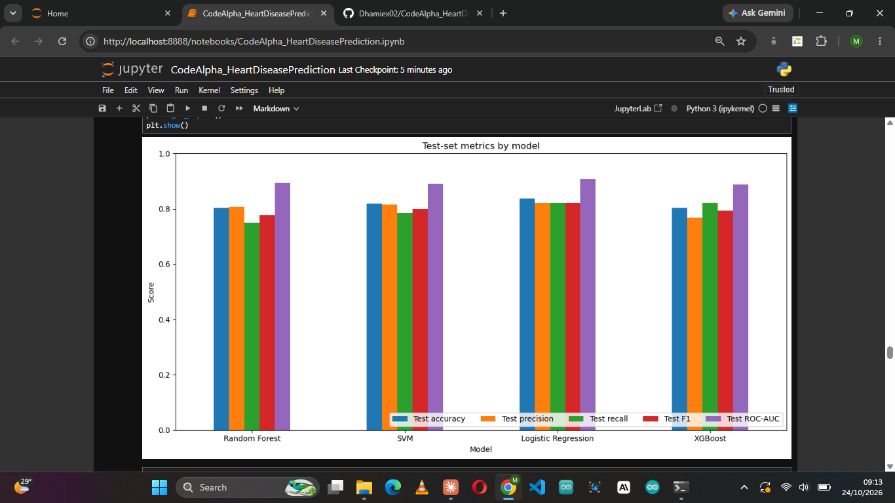
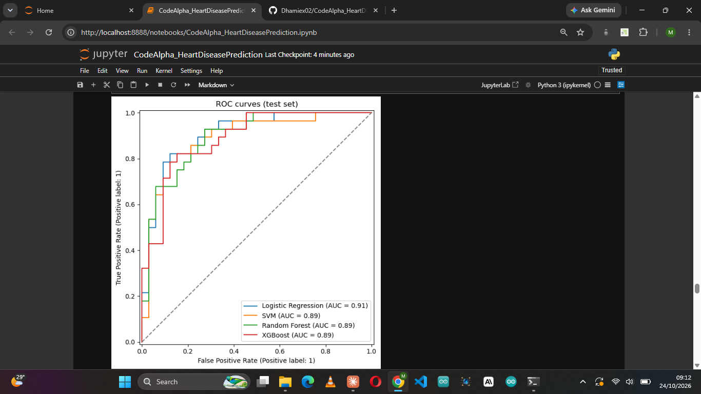
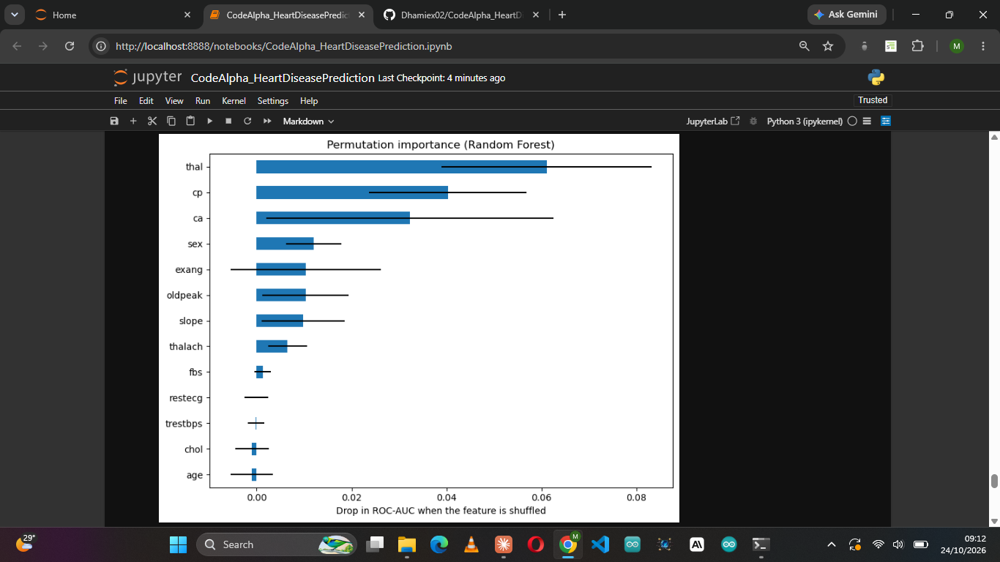

# Heart Disease Prediction

**CodeAlpha Machine Learning Internship, Task 4: Disease Prediction from Medical Data**

A machine learning pipeline that predicts the presence of heart disease from 13 clinical measurements. Four classification algorithms (Logistic Regression, SVM, Random Forest, XGBoost) are tuned with cross-validated grid search, compared fairly, and the best one is saved as a ready-to-use pipeline.

> **Disclaimer:** this is an educational project, not a medical device. It must not be used to diagnose or make decisions about real patients.

## Results

**Selected model: Random Forest** (100 trees, `max_depth = 4`, `min_samples_leaf = 2`), chosen because it had the best cross-validated ROC-AUC on the training data (0.925).

| Metric (test set, 61 patients) | Value | 95% bootstrap range |
|---|---|---|
| Accuracy | 80.3% (49 / 61 correct) | 70.5% to 90.2% |
| Recall (disease cases found) | 0.750 | 0.581 to 0.900 |
| Precision | 0.808 | |
| F1-score | 0.778 | |
| ROC-AUC | 0.894 | 0.802 to 0.965 |

On the test set, the model found 21 of 28 patients with heart disease (7 missed) and raised 5 false alarms among 33 patients without it.

The ranges come from resampling the 61-patient test set 1,000 times. They are wide because the test set is small, so the results should be read as "roughly 80% accuracy", not as a precise figure.

### All models compared

| Model | CV ROC-AUC | Test accuracy | Precision | Recall | F1 | Test ROC-AUC |
|---|---|---|---|---|---|---|
| **Random Forest (selected)** | **0.9246** | 0.8033 | 0.8077 | 0.7500 | 0.7778 | 0.8939 |
| SVM | 0.9167 | 0.8197 | 0.8148 | 0.7857 | 0.8000 | 0.8907 |
| Logistic Regression | 0.9160 | 0.8361 | 0.8214 | 0.8214 | 0.8214 | 0.9069 |
| XGBoost | 0.9141 | 0.8033 | 0.7667 | 0.8214 | 0.7931 | 0.8885 |

**How to read this table.** Models were selected by cross-validated ROC-AUC on the training set, and the test set was used only to report performance. The four cross-validated scores lie within 0.011 of each other, and one test patient is worth about 1.6 percentage points, so the models are statistically close. Logistic Regression scored slightly higher on the test set, but choosing a model by its test score would leak information from the test data.




### Recall versus false alarms

In disease screening, a missed case is usually worse than a false alarm. Lowering the decision threshold of the selected model catches more cases at the cost of more false alarms:

| Threshold | Precision | Recall | Missed cases | False alarms |
|---|---|---|---|---|
| 0.3 | 0.703 | 0.929 | 2 | 11 |
| 0.4 | 0.727 | 0.857 | 4 | 9 |
| **0.5 (default)** | 0.808 | 0.750 | 7 | 5 |
| 0.6 | 0.826 | 0.679 | 9 | 4 |

### Which measurements matter

Permutation importance on the test set shows how much the model's ROC-AUC drops when each measurement is shuffled.



## Label correction

The dataset documents `target = 1` as heart disease, but the data contradict this. The group means for `target = 1` were a **higher** maximum heart rate (158 vs 139), **lower** ST depression (0.59 vs 1.59) and **less** exercise-induced angina (0.14 vs 0.55), which is the opposite of what medicine predicts for patients with heart disease. The notebook therefore checks the group means and, when they look reversed, flips `target` so that **1 = disease** holds throughout. After the flip, 138 of 302 patients (45.7%) are labelled as having disease, and the means point in the clinically expected direction. As a sanity check, a 70-year-old patient with exercise-induced angina and ST depression of 2.6 gets an 85% estimated probability of disease.

This choice can be overridden with the `FLIP_LABELS` switch in the notebook.

## Dataset

- **Source:** the UCI heart disease data (14 attributes), used as `heart.csv`.
- **Size:** 1,025 rows, of which **723 were exact duplicates**. After removing them, **302 unique patients** remain. Duplicates are removed *before* splitting so the same patient cannot appear in both train and test.
- **Features (13):** age, sex, chest pain type (`cp`), resting blood pressure (`trestbps`), cholesterol (`chol`), fasting blood sugar (`fbs`), resting ECG (`restecg`), maximum heart rate (`thalach`), exercise-induced angina (`exang`), ST depression (`oldpeak`), ST slope (`slope`), number of major vessels (`ca`), thalassemia (`thal`).
- **Error codes:** `thal = 0` (2 rows) and `ca = 4` (4 rows) are invalid values. They are converted to missing values and imputed inside the pipeline.
- **Outliers:** found by the IQR rule in `trestbps` (9), `chol` (5), `oldpeak` (5) and `thalach` (1). They were **kept**, because extreme clinical values can be genuine patients.

## Approach

1. **Clean:** remove duplicates, convert error codes to missing values, run the label check.
2. **Explore:** disease rate by category, distributions by outcome, correlation heatmap, outlier analysis.
3. **Split first:** 80/20 stratified train/test split (241 / 61 patients), before any scaling or encoding.
4. **Preprocess inside a `Pipeline`** so nothing leaks from the test data:
   - numeric features (`age`, `trestbps`, `chol`, `thalach`, `oldpeak`): median imputation, then standard scaling
   - categorical features (`sex`, `cp`, `fbs`, `restecg`, `exang`, `slope`, `ca`, `thal`): most-frequent imputation, then one-hot encoding
5. **Tune:** `GridSearchCV` with 5-fold stratified cross-validation, optimising ROC-AUC, on the training set only.
6. **Compare** the four tuned models on the untouched test set and select the best by cross-validated ROC-AUC.
7. **Quantify uncertainty** with a bootstrap over the test set, and **explain** the model with permutation importance.
8. **Save** the winning pipeline with `joblib`.

## Repository structure

```
CodeAlpha_HeartDiseasePrediction/
├── CodeAlpha_HeartDiseasePrediction.ipynb   # full notebook
├── heart.csv                                # dataset
├── heart_model.joblib                       # saved pipeline (Random Forest)
├── images/                                  # figures used in this README
├── requirements.txt
└── README.md
```

## How to run

```bash
git clone https://github.com/Dhamiex02/CodeAlpha_HeartDiseasePrediction.git
cd CodeAlpha_HeartDiseasePrediction
pip install -r requirements.txt
jupyter notebook CodeAlpha_HeartDiseasePrediction.ipynb
```

Run the cells from top to bottom. Training takes a short while because of the grid searches.

### Predict for a new patient

```python
import joblib
import pandas as pd

model = joblib.load("heart_model.joblib")

patient = pd.DataFrame([{
    "age": 70, "sex": 1, "cp": 0, "trestbps": 145, "chol": 174, "fbs": 0,
    "restecg": 1, "thalach": 125, "exang": 1, "oldpeak": 2.6,
    "slope": 0, "ca": 0, "thal": 3,
}])

print("Probability of heart disease:", model.predict_proba(patient)[0, 1])
```

## Requirements

`requirements.txt`:

```
pandas
numpy
matplotlib
seaborn
scikit-learn
xgboost
joblib
jupyter
```

## Limitations and future work

- **Small data:** 302 unique patients from a single source. The test set has only 61 patients, so every metric carries wide uncertainty (see the bootstrap ranges).
- **Missed cases:** at the default threshold the selected model misses about 1 in 4 patients with disease. A lower threshold trades these for more false alarms (see the threshold table).
- **Label correction:** the label direction was inferred from clinical expectation and should be verified against the original UCI source before drawing clinical conclusions.
- **Category names:** the text labels for encoded features such as `restecg` follow the dataset documentation and may not match the original coding.
- **No external validation:** results have not been checked on another hospital or population.
- **Future work:** calibrate the predicted probabilities, add SHAP explanations for individual patients, and test on a second heart-disease dataset.

## Author

**Fayemi Oluwadamilare'**
[LinkedIn](https://www.linkedin.com/in/fayemi-oluwadamilare-a7a78a2a7) · [GitHub](https://github.com/Dhamiex02)

Built as part of the CodeAlpha Machine Learning Internship.
